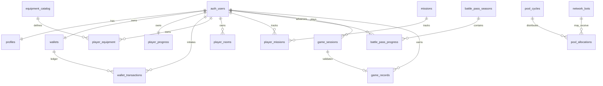

# Mining Pix — modelo relacional PostgreSQL

**Status:** modelo de referência em evolução; as tabelas e operações marcadas como implementadas já possuem migrations DEV versionadas. Consulte `supabase/README.md` para a sequência aplicada.  
**Convenções:** UUID como PK; `timestamptz` em UTC; `numeric` para valores econômicos (nunca float); `auth.users(id)` como identidade; `user_id` como proprietário de dados privados.

## 1. Diagrama lógico resumido

## 2. Tabelas

### Identidade e autorização

| Tabela | Campos principais | Regras |
|---|---|---|
| `profiles` | `user_id PK/FK auth.users`, `display_name`, `avatar_path`, `created_at`, `updated_at` | Dados de perfil; usuário atualiza somente campos permitidos do próprio perfil. |
| `admin_roles` | `id`, `user_id FK`, `role`, `granted_by`, `granted_at`, `revoked_at` | Escrita somente por processo administrativo confiável; nunca pelo usuário comum. Papéis iniciais: `admin`, `moderator`, `support` se necessários. |

Não expor e-mail ou metadados privados em consultas públicas de perfil. A atribuição de papel deve ocorrer por dashboard/SQL administrativo protegido ou função restrita, nunca por cadastro público.

### Carteira e trilha de auditoria

| Tabela | Campos principais | Regras |
|---|---|---|
| `wallets` | `user_id PK/FK`, `balance numeric(20,0)`, `created_at`, `updated_at`, `version bigint` | Uma carteira por jogador. Saldo >= 0. Sem INSERT/UPDATE/DELETE direto pelo cliente. |
| `wallet_transactions` | `id`, `user_id`, `amount numeric(20,0)`, `balance_after numeric(20,0)`, `type`, `reference_type`, `reference_id`, `idempotency_key`, `description`, `created_at`, `actor_user_id` | Ledger append-only. Crédito positivo, débito negativo. Unique por `(user_id,idempotency_key)`. Sem UPDATE/DELETE para cliente. |
| `admin_audit_logs` | `id`, `actor_user_id`, `target_user_id`, `action`, `entity_type`, `entity_id`, `reason`, `before_data jsonb`, `after_data jsonb`, `metadata jsonb`, `request_id`, `created_at` | Append-only; INSERT somente por `service_role`; leitura administrativa via RPC protegida; sem armazenar segredos. |

O saldo em `wallets` é um agregado transacional para leitura rápida; `wallet_transactions` é a trilha contábil virtual. Ambos são atualizados na mesma transação por RPC. Correções usam lançamentos compensatórios, não edição de registros antigos.

### Progressão, equipamentos e salas

| Tabela | Campos principais | Regras |
|---|---|---|
| `player_progress` | `user_id PK/FK`, `xp bigint`, `level integer`, `vip_tier smallint`, `premium_pass boolean`, `created_at`, `updated_at` | Valores não negativos; alterações somente por operações autorizadas. |
| `equipment_catalog` | `id`, `code unique`, `name`, `category`, `hashrate`, `price_pc`, `enabled`, `version` | Catálogo global administrado; preço e hashrate não vêm do cliente. |
| `player_equipment` | `id`, `user_id`, `catalog_id FK`, `state`, `room_id nullable`, `acquired_at`, `metadata jsonb` | Estado: `inventory`, `installed`, `consumed`; dono sempre vinculado ao usuário. |
| `player_rooms` | `id`, `user_id`, `name`, `capacity`, `created_at` | Capacidade e quantidade de salas validadas pelo tier/plano no servidor. |
| `economy_config` | `key PK`, `value jsonb`, `version`, `updated_by`, `updated_at` | Configuração global restrita; mudanças auditadas e versionadas. |

Evitar armazenar preço efetivo apenas em `player_equipment`: guardar referência de catálogo e, quando necessário para histórico, snapshot de preço de aquisição no evento/ledger.

### Missões e passe de batalha

| Tabela | Campos principais | Regras |
|---|---|---|
| `missions` | `id`, `code unique`, `period`, `definition jsonb`, `starts_at`, `ends_at`, `enabled`, `version` | Definições globais versionadas; não editáveis por jogador. |
| `player_missions` | `id`, `user_id`, `mission_id FK`, `period_key`, `progress`, `completed_at`, `claimed_at` | Unique `(user_id,mission_id,period_key)`; progresso vindo de eventos validados. |
| `battle_pass_seasons` | `id`, `code unique`, `starts_at`, `ends_at`, `max_level`, `rewards jsonb`, `enabled` | Temporada global e catálogo de recompensas versionados. |
| `battle_pass_progress` | `id`, `user_id`, `season_id FK`, `xp`, `claimed_free_levels jsonb`, `claimed_premium_levels jsonb`, `updated_at` | Unique `(user_id,season_id)`; validação de trilha premium no servidor. |

### Jogos

| Tabela | Campos principais | Regras |
|---|---|---|
| `game_sessions` | `id`, `user_id`, `game_code`, `rules_version`, `nonce`, `seed`, `started_at`, `expires_at`, `status`, `submitted_at`, `validation_data jsonb` | Sessões emitidas pelo servidor; nonce único; status controlado por transições válidas. |
| `game_records` | `id`, `user_id`, `session_id unique FK`, `score`, `won`, `duration_ms`, `validated_at`, `reward_transaction_id nullable FK` | Só persistir recorde/recompensa depois de validar sessão; impedir múltiplos registros por sessão. |

A validação depende de cada jogo. Preferir replay determinístico de inputs/eventos contra regras versionadas, com limites de tempo e estado. Seed não torna um resultado confiável se o cliente puder escolher o resultado final. Se um jogo não permitir validação adequada, manter recordes/recompensas como não verificados ou apenas locais.

### Mining Pool

| Tabela | Campos principais | Regras |
|---|---|---|
| `pool_cycles` | `id`, `cycle_key unique`, `started_at`, `closed_at`, `budget_pc`, `total_hashrate`, `rules_version`, `status`, `created_at` | Ciclo criado/fechado por processo autorizado; chave única impede duplicação. |
| `network_bots` | `id`, `code unique`, `display_name`, `hashrate`, `active`, `balance_pc`, `created_at`, `updated_at` | Entidades simuladas globais controladas pelo servidor/admin. Se bots tiverem recompensas, registrá-las em alocações separadas, não em carteiras de jogadores. |
| `pool_allocations` | `id`, `cycle_id FK`, `user_id nullable`, `bot_id nullable`, `hashrate_snapshot`, `share`, `amount_pc`, `created_at` | Exatamente um destino (jogador ou bot); unique por ciclo e destino; snapshot imutável. |

A alocação usa hashrate congelado no início/fechamento definido da janela. Definir regra de arredondamento e tratamento do resto em especificação versionada. Se o orçamento for creditado a jogadores, gravar a alocação e a transação da carteira na mesma transação SQL.

## 3. Relações e constraints obrigatórias

- FK para `auth.users(id)` em todo dado privado.
- `CHECK(balance >= 0)`, `CHECK(xp >= 0)`, `CHECK(amount_pc >= 0)` onde aplicável.
- `UNIQUE(user_id, idempotency_key)` em ledger.
- `UNIQUE(cycle_key)` em ciclos.
- `UNIQUE(cycle_id,user_id)` e `UNIQUE(cycle_id,bot_id)` em alocações, com constraint que exige exatamente um destinatário.
- `UNIQUE(user_id,mission_id,period_key)` em missões.
- `UNIQUE(user_id,season_id)` em passe.
- `UNIQUE(session_id)` em recordes.
- Índices em `user_id`, datas de criação, status e chaves de consulta.
- Valores econômicos em inteiro de PC ou `numeric`, nunca `real`/`double precision`.
- Soft-delete apenas quando houver necessidade de produto; ledger, ciclos e auditoria não são apagados.

## 4. Operações transacionais (RPC)

| RPC/caso de uso | Operação atômica | Validações |
|---|---|---|
| `purchase_equipment` | Bloqueia carteira, debita PC, cria item e ledger | dono, catálogo habilitado, preço do servidor, saldo e idempotência |
| `dismantle_equipment` | Atualiza item, credita refund e ledger | propriedade, estado e valor de reembolso calculado no servidor |
| `claim_mission_reward` | Marca missão reivindicada, credita XP e ledger se houver PC | progresso validado, janela e não reivindicada |
| `claim_battle_reward` | Marca nível resgatado e entrega item/benefício | XP, temporada, trilha e premium entitlement |
| `complete_game_session` | Valida sessão, cria recorde, progresso e recompensa | nonce, tempo, regras, replay/validação e idempotência |
| `settle_pool_cycle` | Fecha ciclo, cria snapshots/alocações e credita jogadores | papel de serviço, ciclo aberto, orçamento, participantes e unicidade |
| `admin_adjust_wallet` | Lançamento compensatório e log administrativo | papel admin, motivo, alvo, saldo não negativo e request id |

As funções devem ter grants explícitos; revogar execução de funções sensíveis de `PUBLIC` e conceder apenas a `authenticated` ou ao papel de serviço adequado. Funções `SECURITY DEFINER` exigem `search_path` fixo, qualificação de objetos e revisão de privilégios.

## 5. Estratégia de consultas

- Leitura do próprio dashboard por views/queries protegidas por RLS.
- Não criar views que inadvertidamente ignorem RLS; revisar opção de security invoker quando aplicável à versão PostgreSQL/Supabase usada.
- Dados agregados globais públicos devem ser expostos por view/função que revele somente métricas aprovadas, sem dados privados.
- Paginar histórico e limitar resultados.
- Não retornar logs administrativos ou metadados internos ao cliente comum.

## 6. Itens para validar antes da migration

- Escolher se VIP/passe premium são apenas flags sandbox ou entitlement concedido por compra externa futura.
- Definir regras finais de ciclos e precisão/arredondamento.
- Definir método verificável por jogo e se cada jogo pode conceder PC.
- Decidir se bots são somente participantes visuais da pool ou se suas reservas são contabilizadas separadamente.
- Definir retenção de sessões, eventos e logs.
- Testar constraints e políticas com pelo menos dois usuários e um admin.

## 7. Modelo implementado na Fase 2C

### `player_rooms`
- `id`, `user_id`, `room_number` (1–4), `name`, `created_at`.
- Unique `(user_id, room_number)` e `(id, user_id)`.
- RLS de leitura própria; escrita somente por triggers/RPC.
- Trigger provisiona 1 + VIP tier salas; downgrade remove salas vazias e bloqueia remoção de sala com equipamento instalado.

### Extensões de `player_equipment`
- `room_id nullable`, FK composta `(room_id,user_id)` para impedir sala de outro jogador.
- Estado `installed` exige sala; `inventory` e `retired` exigem `room_id IS NULL`.
- Até 10 equipamentos por sala, validados sob lock da linha da sala.

### `player_equipment_operations`
- Histórico append-only de instalação/desinstalação com chave idempotente única por usuário.
- SELECT próprio via RLS; sem escrita direta do cliente.

### Operações implementadas
- `install_player_equipment`: valida dono, VIP, sala, estado e capacidade; altera equipamento e registra operação atomicamente.
- `uninstall_player_equipment`: devolve item ao inventário e registra operação atomicamente.
- `rename_player_room`: valida nome e propriedade.
- `get_player_mining_summary`: SECURITY INVOKER; calcula hashrate e capacidade a partir das linhas visíveis via RLS.

A instalação persistente não altera carteira nem gera recompensas. O simulador local continua independente.

### Resumo por sala

A função `get_player_room_summaries()` retorna somente salas ativas do usuário autenticado, com contagem instalada, hashrate agregado no banco e capacidade fixa de 10 slots. É SECURITY INVOKER e respeita RLS.

## 8. Mining Pool persistente — implementado na Fase 3

- `pool_cycles`: ciclo com chave única, orçamento inteiro explícito, status e snapshot agregado. Índice parcial garante no máximo um ciclo aberto.
- `pool_allocations`: snapshot imutável por jogador/ciclo, participação, PC atribuídos e referência ao ledger. RLS limita a leitura às próprias linhas.
- `get_pool_dashboard()`: SECURITY DEFINER com `auth.uid()` obrigatório; retorna somente hashrate próprio, agregado global, ciclo aberto e histórico próprio. Não retorna a lista de jogadores nem dados privados.
- `open_pool_cycle()` e `settle_pool_cycle()`: execução restrita a `service_role`. A liquidação calcula participação com hashrate persistente, usa maiores restos para fechar a soma inteira e atualiza carteira, ledger, alocações e status na mesma transação.
- `pool-operator` Edge Function exige claim server-managed `app_metadata.pool_operator=true`; não confia em `user_metadata`.
- Bots do sandbox e hashrate temporário de jogos não participam. Não há emissão automática: cada ciclo exige orçamento inteiro explícito.
- Frequência e política econômica permanecem decisões de produto antes de ativar ciclos recorrentes.

## 9. Revenue Ledger BRL — DEV

### private.revenue_ledger_entries

- Ledger append-only para eventos de receita recebidos, liquidados e conciliados.
- Fontes: pix_coin, vip, premium_pass e advertising.
- Tipos: gross_receipt, payment_fee, tax, refund, chargeback, other_deduction e correction.
- Valores em centavos inteiros BRL (bigint com sinal); créditos positivos e deduções negativas.
- Referências de origem, liquidação, timestamp e chave idempotente obrigatórias.
- RLS habilitado; leitura explícita para service_role; sem escrita direta por cliente.
- Trigger bloqueia UPDATE, DELETE e TRUNCATE. Correções devem ser novos lançamentos compensatórios.

### Funções privadas

- private.record_revenue_ledger_entry(...): gravação idempotente de evento liquidado; somente service_role; retry com payload igual retorna o lançamento existente, chave reutilizada com dados divergentes é rejeitada.
- private.get_revenue_period_summary(p_period_start, p_period_end): agrega recebimentos e deduções pela janela de settled_at; somente service_role.

O ledger ainda não recebe eventos de gateway ou rede de anúncios. Não existe fechamento mensal, carry-forward de chargebacks tardios, alocação automática de receita, reserva financeira ou orçamento Pool integrado. A função de resumo não autoriza distribuição. Consulte docs/REVENUE_LEDGER.md e docs/MINING_POOL.md.

## 10. Financial Intelligence Center — DEV

### Ledgers privados

- `private.operational_expense_entries`: despesas efetivamente pagas em centavos BRL; append-only, idempotentes e vinculadas a referência, data e administrador.
- `private.financial_commitments`: obrigações abertas/pagas/canceladas. Obrigações comerciais usam BRL em centavos; compromissos de recompensa usam MC em `numeric(30,8)`, sem conversão.
- `private.financial_commitment_events`: histórico append-only de criação, baixa e cancelamento.
- `private.reserve_fund_movements`: aportes/retiradas contábeis em centavos BRL; retirada não excede o saldo.
- `private.financial_admin_events`: trilha append-only das operações financeiras administrativas.
- `private.financial_expense_month_closings`: fechamento imutável de meses completos, com total de despesas capturado no fechamento.
- `private.economy_supply_snapshots`: snapshots manuais de oferta PC, carteiras, equipamentos, hashrate e jogadores.
- `private.player_activity_events`: telemetria de sessão e gameplay, sem autoridade para conceder recompensas.

### RPCs e Edge Function

- `public.admin_financial_snapshot()`: read model validado por `auth.uid()` e `app_metadata.admin=true`.
- `public.admin_capture_economy_snapshot()`: captura manual de snapshot PC, somente admin.
- `public.admin_close_expense_month(...)`: fechamento de mês completo, service-role-only.
- `public.admin_record_operational_expense(...)`: lançamento idempotente de despesa efetivamente paga; bloqueia novas despesas retroativas em mês fechado.
- `public.admin_create_financial_commitment(...)`: registra compromisso BRL ou MC separado.
- `public.admin_record_reserve_movement(...)`: registra aporte/retirada contábil com lock e idempotência.
- `public.admin_transition_financial_commitment(...)`: baixa de compromisso BRL vinculada a despesa de valor igual ou cancelamento auditado.
- Edge Function `admin-finance`: JWT obrigatório, origem permitida, validação de usuário/claim admin e service role exclusivamente no backend.

### Regras de reserva e previsão

- Meta da reserva = soma das despesas pagas dos três últimos meses completos.
- A meta só é exibida como válida após os três meses estarem fechados.
- Fechamento captura o total do mês, é append-only e bloqueia novas despesas retroativas. Fluxo de ajustes de mês fechado ainda não existe.
- Previsão de receita para o próximo mês = média simples da receita líquida conciliada dos três últimos meses completos; não é garantia.
- Alocação de referência aprovada: 30% Pool, 30% reserva, 30% operação/desenvolvimento, 10% administração. Ainda não movimenta fundos automaticamente.
- Compromissos de recompensa são exibidos por vencimento em MC e nunca convertidos para BRL.

### Telemetria e economia virtual

- `public.record_player_activity_event(...)` grava eventos autenticados para analytics; sessão tem throttle de 15 minutos.
- Início/conclusão de partidas são eventos client-reported, não prova de vitória elegível, HASH ou recompensa.
- Inflação monetária inicial é acompanhada por oferta PC, emissão e sinks. Índice de preços requer cesta versionada de itens/serviços; ainda não implementado.
- Snapshots PC são manuais; comparativo de 30 dias requer uma linha de base com pelo menos 30 dias.

### Segurança e QA

- Tabelas privadas com RLS e sem grants diretos a clientes.
- Operações administrativas passam pela Edge Function e RPCs service-role-only, com revalidação do administrador no banco.
- Ledgers e auditoria são append-only; termos de compromissos são imutáveis.
- QA DEV transacional cobriu despesas, compromissos BRL/MC, baixa vinculada, idempotência, aportes, retirada insuficiente, fechamento de três meses, snapshot de total, bloqueio de lançamento retroativo e retry após fechamento. Todos os testes foram revertidos.
- Nenhuma receita, despesa, compromisso, movimento de reserva, evento de atividade ou snapshot de teste permanece persistido.
